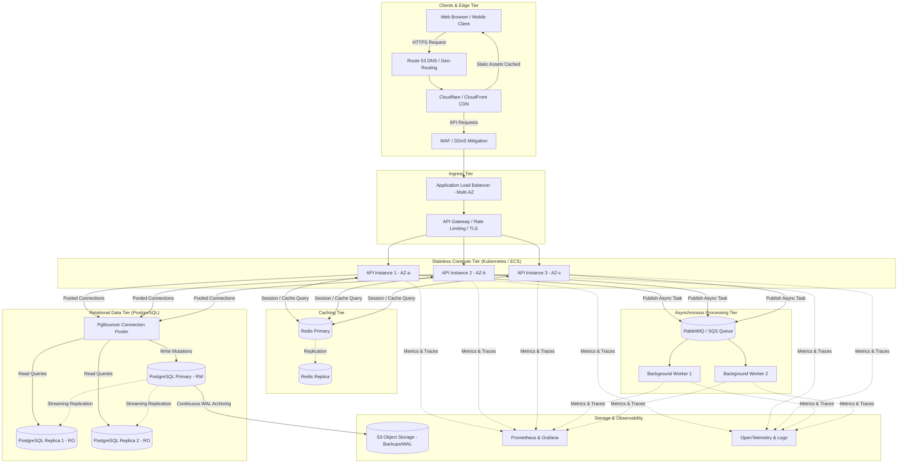

# QuickNotes System Architecture Design

> **Specification Version:** 1.0.0
> **Target Scale:** 1,000,000 Registered Users
> **Status:** Proposed Production Architecture Design
> **Implementation Clarification:** This document specifies the proposed production backend architecture for enterprise-grade scale. The currently implemented codebase includes the responsive frontend prototype (`index.html`, `style.css`, and `api.js`) utilizing the JSONPlaceholder mock service for client-side demonstration.

---

## 1. Executive Summary & Design Goals

The QuickNotes backend architecture is designed to support **1,000,000 registered users** with high availability, low latency, robust data durability, and zero single points of failure (SPOF).

### Key Design Goals:
- **Availability:** 99.99% uptime (< 52.6 minutes of downtime/year).
- **Latency:** p95 latency < 100ms for read operations; p95 latency < 200ms for write operations.
- **Scalability:** Horizontal scaling capable of absorbing 5x traffic surges.
- **Data Durability:** RPO (Recovery Point Objective) < 1 minute; RTO (Recovery Time Objective) < 10 minutes.

---

## 2. Workload Assumptions & Quantitative Capacity Planning

To properly size the infrastructure, realistic usage patterns and quantitative workload calculations are defined below.

### 2.1 User Metrics & Traffic Assumptions
- **Registered Users ($N$):** 1,000,000 users.
- **Daily Active Users (DAU):** 20% of registered base = **200,000 DAU**.
- **User Activity Profile (per active user per day):**
  - Average sessions: 3 sessions/day.
  - Read actions (view notes, list notes, search, tag query): **25 reads/day**.
  - Write actions (create note, edit note, delete note): **5 writes/day**.
  - Total requests per DAU per day: **30 requests/day**.
- **Read-to-Write Ratio:** $25 : 5 = 5 : 1$ (83.3% reads, 16.7% writes).

### 2.2 Requests Per Second (RPS) Calculations
$$\text{Total Daily Requests} = 200,000 \text{ DAU} \times 30 \text{ requests/day} = 6,000,000 \text{ requests/day}$$

$$\text{Average RPS} = \frac{6,000,000 \text{ requests}}{86,400 \text{ seconds/day}} \approx 69.4 \text{ RPS} \quad (\approx 70 \text{ RPS})$$

- **Daily Read Requests:** $200,000 \times 25 = 5,000,000 \text{ reads/day}$ ($\approx 58 \text{ read RPS}$ average).
- **Daily Write Requests:** $200,000 \times 5 = 1,000,000 \text{ writes/day}$ ($\approx 11.6 \text{ write RPS}$ average).

#### Peak Traffic Multiplier:
Web applications experience peak traffic concentrated during daytime business and evening hours. Applying an industry-standard **4x peak multiplier**:

$$\text{Peak RPS} = 69.4 \times 4 \approx 280 \text{ to } 350 \text{ RPS}$$

- **Target Capacity Planning:** The architecture is provisioned with headroom to support up to **500 RPS** sustained peak burst traffic without degradation.

---

### 2.3 Storage Capacity Calculations
- **Total Notes Created:** An average of 50 notes per registered user across the 1,000,000 user accounts:
  $$\text{Total Notes} = 1,000,000 \text{ users} \times 50 \text{ notes} = 50,000,000 \text{ notes}$$
- **Data Size Breakdown per Note Record:**
  - Note ID (UUIDv4): 16 bytes (stored as UUID)
  - User ID (UUIDv4): 16 bytes
  - Title (VARCHAR 100): ~50 bytes average
  - Body (TEXT, optional): ~500 bytes average (accounting for empty and longer notes)
  - Timestamps, flags, metadata: ~68 bytes
  - Estimated raw storage per note: **~650–700 bytes**.

$$\text{Raw Notes Table Size} = 50,000,000 \times 700 \text{ bytes} \approx 35 \text{ GB}$$

- **Ancillary Relational Data:**
  - `users` table: $1,000,000 \times 300 \text{ bytes} \approx 300 \text{ MB}$.
  - `tags` table ($1,000,000 \text{ users} \times 5 \text{ tags} \times 100 \text{ bytes}$) $\approx 500 \text{ MB}$.
  - `note_tags` junction table ($50,000,000 \times 2 \text{ tags} \times 40 \text{ bytes}$) $\approx 4 \text{ GB}$.
- **Indexes & Overhead:**
  - B-tree indexes + Full-Text Search GIN index: ~1.4x raw data = **~55 GB**.
- **Total Primary Database Storage:**
  $$\text{Total Database Storage} \approx 35 \text{ GB} + 5 \text{ GB} + 55 \text{ GB} \approx 95 \text{ GB}$$
- **Provisioned Storage:** To accommodate 3-year growth (25% year-over-year) and Write-Ahead Log (WAL) retention, the primary database is provisioned with **250 GB to 500 GB NVMe SSD** (e.g., AWS EBS `gp3` with 12,000 IOPS).

### 2.4 Caching Memory Sizing (Redis)
- **Active Working Set (80/20 Rule):** 20% of active users account for 80% of daily reads:
  $$40,000 \text{ users} \times 20 \text{ recent notes cache} \times 1.5 \text{ KB} \approx 1.2 \text{ GB}$$
- **Session Tokens, Rate Limits, and Metadata:** ~2 GB.
- **Recommended Cache Allocation:** A **6 GB to 10 GB Redis Cluster** (e.g., AWS ElastiCache `cache.m6g.large` with 1 primary and 1 replica) easily retains the entire hot working set in RAM with >95% cache hit rates.

---

## 3. High-Level Infrastructure Architecture

---

## 4. Component Roles & Architectural Responsibilities

### 4.1 Content Delivery Network (CDN) & Web Application Firewall (WAF)
- **CDN (e.g., Cloudflare, AWS CloudFront):** Caches and serves static assets (`index.html`, `style.css`, `api.js`, SVGs) at 300+ edge locations globally. Reduces latency to <25ms for initial asset downloads and offloads 90% of static traffic from origin servers.
- **WAF:** Positioned directly in front of public endpoints to inspect incoming traffic against OWASP Top 10 vulnerabilities (SQL injection, XSS, HTTP request smuggling), block malicious IP ranges, and mitigate layer 7 DDoS floods.

### 4.2 Application Load Balancer (ALB)
- Deployed across multiple Availability Zones (Multi-AZ).
- Handles SSL/TLS termination using modern cipher suites (TLS 1.3).
- Performs continuous health checks (`GET /healthz`) every 5 seconds. Automatically detaches unhealthy instances and reroutes traffic exclusively to healthy compute nodes.
- Distributes incoming HTTP requests using round-robin and least outstanding requests algorithms.

### 4.3 API Gateway
- Centralized ingress management providing:
  - **Rate Limiting:** Enforces token-bucket rate limiting (120 requests/minute per authenticated user, 30 requests/minute per unauthenticated IP) returning `HTTP 429 Too Many Requests`.
  - **Authentication Verification:** Fast JWT cryptographic signature validation at the edge before passing requests downstream.
  - **Request Correlation:** Injects a unique `X-Request-Id` UUID into every request for end-to-end distributed tracing.

### 4.4 Multiple Stateless API Instances
- Containerized microservices (Node.js/TypeScript or Go) deployed across Kubernetes (EKS) or AWS ECS across three Availability Zones.
- **Strictly Stateless:** Instances do not store user sessions, uploaded files, or state on local disk. Any instance can service any request.
- **Horizontal Pod Autoscaling (HPA):** Automatically scales instance count between 3 (minimum for high availability) and 12 instances based on CPU utilization (>65%) and request queue depth.

### 4.5 Distributed Cache (Redis Cluster)
- Deployed as an in-memory cluster with automated primary-replica failover (e.g., AWS ElastiCache for Redis).
- **Caching Strategy (Cache-Aside):**
  - High-frequency user note listings (`GET /api/v1/notes`) are cached under keys `user:{id}:notes:page:{p}` with a 5-minute TTL.
  - Cache is invalidated proactively on write operations (`POST`, `PATCH`, `DELETE`) or via short TTL expiration.
- Manages distributed rate-limiting counters and token revocation blacklists.

### 4.6 PostgreSQL Primary & Read Replicas (Relational Storage)
- **PostgreSQL Primary:** Handles all ACID-compliant write operations (`INSERT`, `UPDATE`, `DELETE`).
- **Read Replicas (2x):** Asynchronous streaming replication continuously syncs data with sub-100ms replica lag. All `GET /api/v1/notes` and `GET /api/v1/tags` queries are routed to read replicas, ensuring heavy read volume never impacts write throughput.
- **PgBouncer Connection Pooling:** Sits between the API instances and the database to manage a pool of persistent connections, avoiding the memory overhead of opening thousands of raw PostgreSQL backend processes.

### 4.7 Asynchronous Message Queue & Background Workers
- **Message Broker (RabbitMQ / AWS SQS):** Decouples latency-sensitive HTTP request cycles from asynchronous background tasks.
- **Worker Fleet:** Dedicated background consumer instances that process:
  - Full-text search re-indexing and tokenization.
  - User activity digests and welcome/alert emails.
  - GDPR account deletion cascade cleanup.
  - Periodic garbage collection and expired session pruning.

### 4.8 Monitoring, Logging & Observability
- **Prometheus & Grafana:** Collects system metrics (RPS, error rate, CPU/memory, database connection pool saturation, cache hit ratios, replica lag).
- **OpenTelemetry & Distributed Tracing:** Traces individual requests across the load balancer, API gateway, compute layer, and database.
- **Centralized Logging (ELK / AWS CloudWatch):** Aggregates structured JSON logs tagged with `requestId` and `userId`.
- **Alerting:** Automated PagerDuty alerts triggered when error rate exceeds 1% over 5 minutes or p95 response time exceeds 300ms.

### 4.9 Automated Backups & Disaster Recovery
- **Continuous Write-Ahead Log (WAL) Archiving:** PostgreSQL WAL records are streamed continuously to encrypted, durable object storage (AWS S3). Enables **Point-In-Time Recovery (PITR)** to any arbitrary second within the trailing 35-day window.
- **Daily Automated Snapshots:** Full EBS volume database snapshots captured every 24 hours and replicated cross-region.
- **Recovery Metrics:** RPO (Recovery Point Objective) < 1 minute; RTO (Recovery Time Objective) < 10 minutes.

### 4.10 Failover Mechanisms
- **Database Multi-AZ Failover:** If the PostgreSQL Primary becomes unavailable, the managed control plane (or Patroni) detects failure within 15 seconds, promotes a synchronous standby replica to Primary, updates DNS records, and resumes traffic with zero data loss.
- **Compute Failover:** If an Availability Zone suffers a catastrophic outage, the ALB stops routing traffic to that AZ, while Kubernetes deploys replacement pods in the remaining two healthy AZs.

---

## 5. High Availability & Elimination of Single Points of Failure (SPOF)

Every tier in the architecture incorporates redundancy and automated failure recovery:

| Architecture Tier | Potential Point of Failure | Redundancy & Recovery Strategy |
| :--- | :--- | :--- |
| **DNS / Edge** | Region/Network partition | Anycast DNS (AWS Route 53) with automated health-check failover; globally distributed Cloudflare CDN. |
| **Ingress** | Load balancer crash | Application Load Balancer is provisioned as an elastic, multi-AZ managed service with automatic horizontal scaling. |
| **Compute** | Pod or server failure | Minimum 3 stateless API pods running across 3 distinct Availability Zones. Kubernetes automatically restarts crashed pods and HPA scales up replacements. |
| **Cache** | Redis primary node crash | Redis Multi-AZ cluster with automatic failover (primary promotes replica within seconds). |
| **Database** | Database host crash | Multi-AZ PostgreSQL with synchronous standby replica. Automated failover promotes standby within 30 seconds. |
| **Queue** | Broker node crash | Clustered RabbitMQ with mirrored queues or AWS SQS (replicated across 3 AZs natively). |

---

## 6. Security Architecture

The production system enforces **Defense-in-Depth** across every network boundary:

1. **Network Segmentation:**
   - **Public Subnet (DMZ):** Contains only the Application Load Balancer and NAT Gateways.
   - **Private Application Subnet:** Contains stateless API instances and background workers. No public IP addresses assigned.
   - **Isolated Database Subnet:** Contains PostgreSQL primary, replicas, and Redis clusters. Accessible strictly from the application security group on specific ports (5432 and 6379).
2. **Encryption:**
   - **In Transit:** TLS 1.3 enforced for all external client-to-ALB communication and internal service-to-service communication.
   - **At Rest:** Database volumes, Redis disks, and S3 backup buckets are encrypted using AWS KMS managed AES-256 keys.
3. **Authentication & Least Privilege:**
   - Stateless JWT tokens with strict signature validation.
   - IAM roles for service accounts (IRSA in Kubernetes), ensuring applications only have permissions to the specific resources they require.
   - Parameterized SQL queries in all database interactions, completely neutralizing SQL Injection vulnerabilities.

---

## 7. Horizontal Scalability Strategy

- **Scale Compute Independently of Storage:** The stateless API tier scales horizontally based on real-time traffic demand (e.g. 3 pods at night up to 12 pods during peak hours) without needing database modifications.
- **Offload Reads to Replicas:** By directing read queries to read replicas and caching recent notes in Redis, over **85% of incoming read requests never touch the PostgreSQL primary instance**.
- **Decouple Heavy Workloads via Queues:** Asynchronous queueing ensures that slow operations (search indexing, sending emails) do not consume API server threads or degrade client response times.
- **Future Partitioning (Sharding):** If the user base expands beyond 10,000,000 users, PostgreSQL can be horizontally sharded by `user_id` using Citus or application-level sharding, allowing infinite horizontal database scaling.
