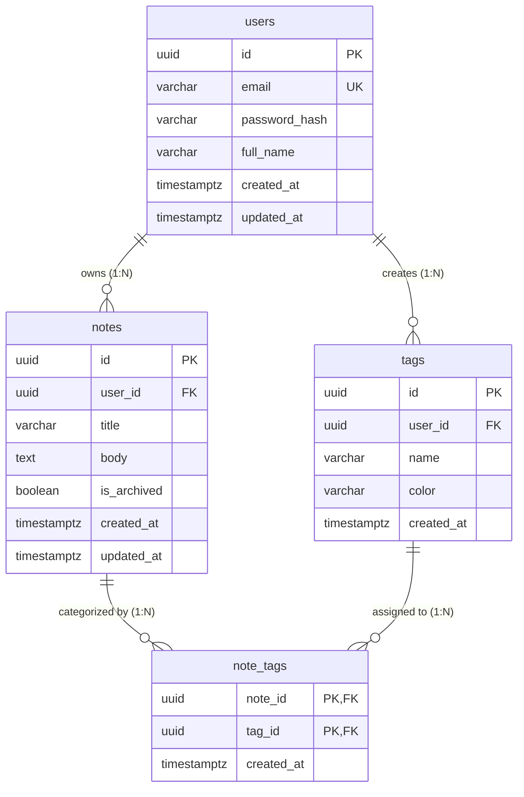

# QuickNotes Relational Data Model Specification

> **Specification Version:** 1.0.0
> **Target Database Engine:** PostgreSQL 16+
> **Status:** Proposed Production Schema Design
> **Prototype Note:** In the current client prototype, notes are managed in-memory with JSONPlaceholder. This specification defines the relational database architecture designed for the production backend platform.

---

## 1. Database Engine Justification: Why PostgreSQL?

For the QuickNotes production backend, **PostgreSQL** was selected over NoSQL document stores (such as MongoDB) and other relational engines (such as MySQL) based on four technical pillars:

1. **ACID Transactions & Referential Integrity:**
   QuickNotes requires relational guarantees across user accounts, note records, tag definitions, and many-to-many associations. When a user creates a note with three tags, the operation must atomically insert the note and junction records (`note_tags`) within a single database transaction. If any part fails, the entire transaction rolls back, preventing orphaned or corrupt associations.
2. **Relational Multi-Tenancy & Cascading Actions:**
   PostgreSQL enforces declarative foreign key constraints (`ON DELETE CASCADE`). When an account is deleted under GDPR compliance ("Right to Erasure"), removing a row from `users` automatically cascades and safely removes all corresponding `notes`, `tags`, and `note_tags` junction entries without requiring complex distributed cleanup logic.
3. **Advanced Indexing & Full-Text Search (FTS):**
   PostgreSQL provides built-in Full-Text Search using Generalized Inverted Indexes (`GIN`) and language stemming (`to_tsvector('english', ...)`). This eliminates the immediate operational overhead and synchronization lag of running a separate Elasticsearch cluster for 1,000,000 users.
4. **Data Typing, Check Constraints & Scalability:**
   PostgreSQL supports native UUID generation (`gen_random_uuid()`), timezone-aware timestamps (`TIMESTAMPTZ`), regex check constraints (e.g. hex color codes), and connection pooling via PgBouncer. It integrates seamlessly with AWS Aurora / RDS multi-AZ deployments and supports streaming replication to multiple read replicas.

---

## 2. Entity-Relationship (ER) Overview

The relational model is organized into four core tables:
- **`users`**: Manages account credentials, profile information, and account timestamps.
- **`notes`**: Stores notes with a **required title** (max 100 characters) and an **optional body**.
- **`tags`**: Defines user-scoped organizational labels with customizable colors.
- **`note_tags`**: Associative junction table resolving the many-to-many relationship between notes and tags.

### Entity Relationship Diagram


---

## 3. Production SQL Schema (DDL)

```sql
-- Enable cryptographic extension for UUID generation
CREATE EXTENSION IF NOT EXISTS "pgcrypto";

-- ============================================================================
-- 1. USERS TABLE
-- ============================================================================
CREATE TABLE users (
    id UUID PRIMARY KEY DEFAULT gen_random_uuid(),
    email VARCHAR(255) NOT NULL,
    password_hash VARCHAR(255) NOT NULL,
    full_name VARCHAR(100),
    created_at TIMESTAMPTZ NOT NULL DEFAULT NOW(),
    updated_at TIMESTAMPTZ NOT NULL DEFAULT NOW(),

    CONSTRAINT uq_users_email UNIQUE (email),
    CONSTRAINT chk_users_email_valid CHECK (email ~* '^[A-Za-z0-9._%+-]+@[A-Za-z0-9.-]+\.[A-Za-z]{2,}$')
);

-- ============================================================================
-- 2. NOTES TABLE
-- Title is required (1-100 characters). Body is optional at the API/schema level.
-- ============================================================================
CREATE TABLE notes (
    id UUID PRIMARY KEY DEFAULT gen_random_uuid(),
    user_id UUID NOT NULL,
    title VARCHAR(100) NOT NULL,
    body TEXT,
    is_archived BOOLEAN NOT NULL DEFAULT FALSE,
    created_at TIMESTAMPTZ NOT NULL DEFAULT NOW(),
    updated_at TIMESTAMPTZ NOT NULL DEFAULT NOW(),

    -- Foreign Key Constraint
    CONSTRAINT fk_notes_user FOREIGN KEY (user_id)
        REFERENCES users (id) ON DELETE CASCADE,

    -- Data Validation Constraints
    CONSTRAINT chk_notes_title_not_empty CHECK (char_length(trim(title)) > 0),
    CONSTRAINT chk_notes_title_max_length CHECK (char_length(title) <= 100),
    CONSTRAINT chk_notes_body_max_length CHECK (body IS NULL OR char_length(body) <= 20000)
);

-- ============================================================================
-- 3. TAGS TABLE
-- User-scoped labels with unique name per account.
-- ============================================================================
CREATE TABLE tags (
    id UUID PRIMARY KEY DEFAULT gen_random_uuid(),
    user_id UUID NOT NULL,
    name VARCHAR(50) NOT NULL,
    color VARCHAR(7) NOT NULL DEFAULT '#6658d3',
    created_at TIMESTAMPTZ NOT NULL DEFAULT NOW(),

    -- Foreign Key Constraint
    CONSTRAINT fk_tags_user FOREIGN KEY (user_id)
        REFERENCES users (id) ON DELETE CASCADE,

    -- Data Validation Constraints
    CONSTRAINT chk_tags_name_not_empty CHECK (char_length(trim(name)) > 0),
    CONSTRAINT chk_tags_name_max_length CHECK (char_length(name) <= 50),
    CONSTRAINT chk_tags_color_hex CHECK (color ~* '^#[0-9A-Fa-f]{6}$'),

    -- Unique per user (a user cannot have two tags with the same name)
    CONSTRAINT uq_user_tag_name UNIQUE (user_id, name)
);

-- ============================================================================
-- 4. NOTE_TAGS JUNCTION TABLE (Many-to-Many Association)
-- ============================================================================
CREATE TABLE note_tags (
    note_id UUID NOT NULL,
    tag_id UUID NOT NULL,
    created_at TIMESTAMPTZ NOT NULL DEFAULT NOW(),

    -- Composite Primary Key
    PRIMARY KEY (note_id, tag_id),

    -- Foreign Key Constraints
    CONSTRAINT fk_notetags_note FOREIGN KEY (note_id)
        REFERENCES notes (id) ON DELETE CASCADE,
    CONSTRAINT fk_notetags_tag FOREIGN KEY (tag_id)
        REFERENCES tags (id) ON DELETE CASCADE
);
```

---

## 4. Trigger for Automated Timestamp Updates

To guarantee that `updated_at` reflects the exact timestamp of modifications without relying on client-supplied values, an automated trigger function is applied to `users` and `notes`.

```sql
CREATE OR REPLACE FUNCTION update_timestamp_column()
RETURNS TRIGGER AS $$
BEGIN
    NEW.updated_at = NOW();
    RETURN NEW;
END;
$$ LANGUAGE plpgsql;

CREATE TRIGGER trg_users_update_timestamp
    BEFORE UPDATE ON users
    FOR EACH ROW
    EXECUTE FUNCTION update_timestamp_column();

CREATE TRIGGER trg_notes_update_timestamp
    BEFORE UPDATE ON notes
    FOR EACH ROW
    EXECUTE FUNCTION update_timestamp_column();
```

---

## 5. Performance Indexes

Indexes are designed to optimize high-frequency query access patterns:

```sql
-- 1. Foreign Key Indexes (Essential for JOIN performance and CASCADE deletions)
CREATE INDEX idx_notes_user_id ON notes (user_id);
CREATE INDEX idx_tags_user_id ON tags (user_id);
CREATE INDEX idx_note_tags_tag_id ON note_tags (tag_id);

-- 2. Composite Index for Paginated User Timeline:
-- Supports "SELECT * FROM notes WHERE user_id = $1 AND is_archived = false ORDER BY updated_at DESC LIMIT 20"
CREATE INDEX idx_notes_user_updated
    ON notes (user_id, updated_at DESC)
    WHERE is_archived = FALSE;

-- 3. Generalized Inverted Index (GIN) for English Full-Text Search across Title and Body:
-- Supports fast text keyword matching without table scans.
CREATE INDEX idx_notes_fts ON notes
    USING GIN (to_tsvector('english', title || ' ' || COALESCE(body, '')));
```

---

## 6. Real-World SQL Join & Query Examples

### Query 1: Paginated Notes Listing with Aggregated Tags
Fetches a page of notes for a given user, joining `notes` with `tags` via `note_tags`, and aggregating tags into a structured JSON array.

```sql
SELECT
    n.id,
    n.title,
    n.body,
    n.created_at,
    n.updated_at,
    COALESCE(
        JSON_AGG(
            JSON_BUILD_OBJECT(
                'id', t.id,
                'name', t.name,
                'color', t.color
            )
        ) FILTER (WHERE t.id IS NOT NULL),
        '[]'::json
    ) AS tags
FROM notes n
LEFT JOIN note_tags nt ON n.id = nt.note_id
LEFT JOIN tags t ON nt.tag_id = t.id
WHERE n.user_id = '3c490a18-5a26-4b2a-bf34-7ad088da1528'
  AND n.is_archived = FALSE
GROUP BY n.id
ORDER BY n.updated_at DESC
LIMIT 20 OFFSET 0;
```

---

### Query 2: Atomic Note Creation with Associated Tags
Demonstrates inserting a note and associating tags within an atomic transaction.

```sql
BEGIN;

-- Step 1: Insert new note (title required, body optional)
INSERT INTO notes (id, user_id, title, body)
VALUES (
    '7a931a54-44df-416b-9c59-bf728e9d29ef',
    '3c490a18-5a26-4b2a-bf34-7ad088da1528',
    'Meeting Action Items',
    'Finalize production architecture review and database migration script.'
);

-- Step 2: Associate with existing tags in note_tags
INSERT INTO note_tags (note_id, tag_id)
VALUES
    ('7a931a54-44df-416b-9c59-bf728e9d29ef', '11d1ecbb-eec0-4a84-916c-e0c20ab99c14')
ON CONFLICT (note_id, tag_id) DO NOTHING;

COMMIT;
```

---

### Query 3: Full-Text Search with Relevance Ranking
Finds notes matching search keywords (`architecture` OR `database`) for a specific user, sorted by relevancy.

```sql
SELECT
    n.id,
    n.title,
    n.body,
    ts_rank(
        to_tsvector('english', n.title || ' ' || COALESCE(n.body, '')),
        to_tsquery('english', 'architecture | database')
    ) AS rank
FROM notes n
WHERE n.user_id = '3c490a18-5a26-4b2a-bf34-7ad088da1528'
  AND n.is_archived = FALSE
  AND to_tsvector('english', n.title || ' ' || COALESCE(n.body, ''))
      @@ to_tsquery('english', 'architecture | database')
ORDER BY rank DESC, n.updated_at DESC
LIMIT 20;
```

---

### Query 4: Filter Notes by Tag
Retrieves all notes tagged with a specific tag UUID for an authenticated user.

```sql
SELECT
    n.id,
    n.title,
    n.body,
    n.updated_at
FROM notes n
INNER JOIN note_tags nt ON n.id = nt.note_id
WHERE nt.tag_id = '11d1ecbb-eec0-4a84-916c-e0c20ab99c14'
  AND n.user_id = '3c490a18-5a26-4b2a-bf34-7ad088da1528'
  AND n.is_archived = FALSE
ORDER BY n.updated_at DESC;
```

---

## 7. Schema Field Mapping to API Specification

| Database Column | Data Type | Constraint | API Field | API Requirement |
| :--- | :--- | :--- | :--- | :--- |
| `notes.id` | UUID | Primary Key | `id` | Read-only identifier |
| `notes.user_id` | UUID | Foreign Key | — | Scoped via JWT authentication |
| `notes.title` | VARCHAR(100) | `NOT NULL`, `CHECK(1-100)` | `title` | **Required** (1–100 chars) |
| `notes.body` | TEXT | `NULL`, `CHECK(<=20000)` | `body` | **Optional** (0–20,000 chars) |
| `notes.is_archived` | BOOLEAN | `DEFAULT FALSE` | — | Internal soft-archive flag |
| `notes.created_at` | TIMESTAMPTZ | `DEFAULT NOW()` | `createdAt` | ISO 8601 UTC timestamp |
| `notes.updated_at` | TIMESTAMPTZ | Managed by Trigger | `updatedAt` | ISO 8601 UTC timestamp |
| `tags.id` | UUID | Primary Key | `tags[].id` | Tag identifier |
| `tags.name` | VARCHAR(50) | `NOT NULL`, Unique per user | `tags[].name` | Tag label |
| `tags.color` | VARCHAR(7) | `CHECK (hex color)` | `tags[].color` | Hex UI color badge |
